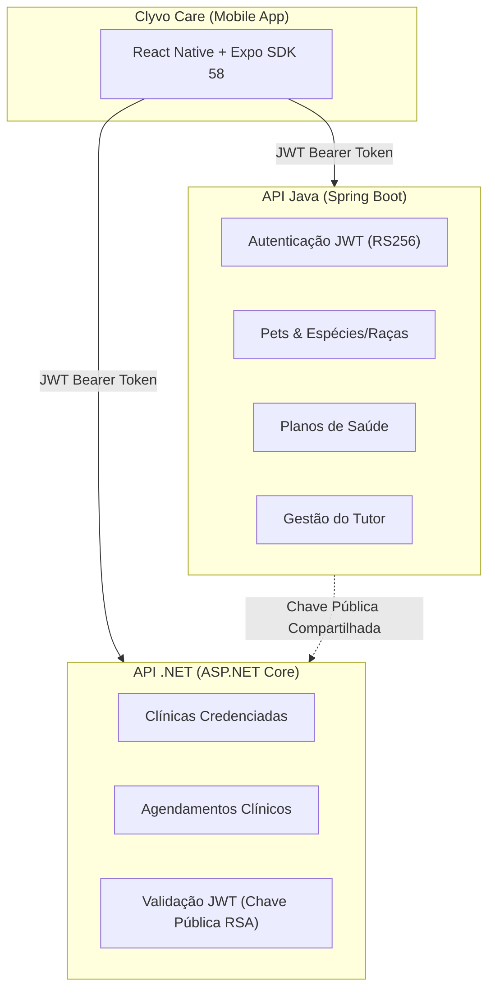
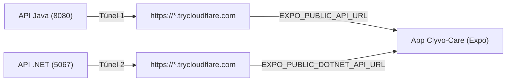

# Clyvo Care — Mobile Application

> **Challenge 2026 — Sprint 4 (Mobile Application)**  
> Aplicativo mobile desenvolvido em **React Native + Expo** integrado às APIs Spring Boot e ASP.NET Core para o ecossistema **Clyvo Vet**, focado na gestão completa da saúde, planos e acompanhamento preventivo de pets.

---

## Sumário
- [Resumo do Projeto](#resumo-do-projeto)
- [Tecnologias Utilizadas](#tecnologias-utilizadas)
- [Vídeo de Demonstração](#vídeo-de-demonstração)
- [Credenciais para Teste e Avaliação](#credenciais-para-teste-e-avaliação)
- [Execução Rápida (com APIs publicadas na Azure)](#execução-rápida-com-apis-publicadas-na-azure)
- [Integração e Repositórios dos Backends](#integração-e-repositórios-dos-backends)
  - [API Java Spring Boot (Gestão, Pets, Planos e Auth)](#1-api-java-spring-boot-gestão-pets-planos-e-auth)
  - [API .NET (Clínicas e Agendamentos)](#2-api-net-aspnet-core--clínicas-e-agendamentos)
- [Solução do Projeto e Funcionalidades](#solução-do-projeto-e-funcionalidades)
  - [Detalhamento de Telas e Endpoints](#detalhamento-de-telas-e-endpoints)
- [Execução em Ambiente Local (Opcional)](#execução-em-ambiente-local-opcional)
  - [Inicialização Tradicional (Wi-Fi Local ou Emulador)](#1-inicialização-tradicional-wi-fi-local-ou-emulador)
  - [Inicialização com Túneis Cloudflare (End-to-End Remoto)](#2-inicialização-com-túneis-cloudflare-end-to-end-remoto)
- [Arquitetura e Estrutura de Pastas](#arquitetura-e-estrutura-de-pastas)
- [Diagnóstico e Comandos Úteis](#diagnóstico-e-comandos-úteis)
- [Integrantes da Equipe](#integrantes-da-equipe)

---

## Resumo do Projeto

O **Clyvo Care** é o portal do tutor dentro do ecossistema veterinário **Clyvo Vet**. Ele foi concebido para centralizar a gestão de saúde, acompanhamento preventivo e serviços para pets em uma experiência intuitiva, moderna e totalmente conectada.

O aplicativo funciona como cliente consumidor de duas APIs independentes:
1. **API Java (Spring Boot):** Gerencia a identidade do tutor (autenticação JWT assimétrica via RSA/RS256), catálogo de espécies, raças, pets associados e contratações de planos de saúde veterinários.
2. **API .NET (ASP.NET Core):** Gerencia o credenciamento de clínicas veterinárias, geolocalização e agendamentos clínicos integrados com disparo de notificações locais.

---

## Tecnologias Utilizadas

### Mobile Application
- **Framework Core:** [React Native](https://reactnative.dev/) & [Expo SDK 58](https://expo.dev/)
- **Linguagem:** [TypeScript](https://www.typescriptlang.org/)
- **Gerenciamento de Estado & Cache Assíncrono:** [TanStack Query v5 (`@tanstack/react-query`)](https://tanstack.com/query)
- **Cliente HTTP:** [Axios](https://axios-http.com/) (com interceptores para injeção de Bearer Token JWT e tratamento global de erros)
- **Roteamento & Navegação:** [React Navigation v7](https://reactnavigation.org/) (`@react-navigation/native-stack`)
- **Notificações:** [Expo Notifications (`expo-notifications`)](https://docs.expo.dev/versions/latest/sdk/notifications/) (notificações locais após confirmação de consultas com redirecionamento dinâmico)
- **Persistência Local:** [AsyncStorage](https://react-native-async-storage.github.io/async-storage/) (sessão do usuário e preferências de tema)
- **Estilização & UI:** [NativeWind v4](https://www.nativewind.dev/) (Tailwind CSS para React Native) com suporte completo a tema Claro (*Light*) e Escuro (*Dark*)
- **Animações:** [React Native Reanimated](https://docs.swmansion.com/react-native-reanimated/) & [React Native Worklets](https://github.com/software-mansion/react-native-worklets)
- **Ícones Vetoriais:** [Lucide React Native](https://lucide.dev/)
- **Build & Metadados de Auditoria:** [Expo Constants](https://docs.expo.dev/versions/latest/sdk/constants/) com captura automatizada do `commitHash` via `app.config.js`
- **Suporte Multiplataforma:** Android, iOS e Web ([React Native Web](https://necolas.github.io/react-native-web/))

### Ecossistema Backend & Infraestrutura
- **Backends:** Java 17 (Spring Boot 3.x) e .NET 9 (ASP.NET Core)
- **Bancos de Dados:** Oracle Database (Schema compartilhado) e MongoDB Atlas (Auditoria clínica)
- **Cloud Hosting:** Microsoft Azure App Services
- **Túneis de Desenvolvimento:** Cloudflare Tunnel (`cloudflared`)

---

## Vídeo de Demonstração

> **Link do Vídeo no YouTube:** [Link do video no Youtube](https://youtu.be/vcfJ3j9KZHc) (Video é da Sprint 3 ainda...)

> *Demonstração completa da aplicação em execução contínua no celular físico, autenticação JWT, navegação protegida, operações de CRUD sincronizadas em tempo real com a API Java e tratamento de estados de carregamento.*

---

## Credenciais para Teste e Avaliação

Para facilitar a homologação e avaliação imediata do aplicativo, utilize a conta de testes pré-configurada:

| Campo | Valor |
| :--- | :--- |
| **E-mail:** | `rural@gmail.com` |
| **Senha:** | `senha123` |

> [!NOTE]
> **Fluxo de Novo Cadastro:** Caso deseje criar um novo usuário tutor, acesse **"Cadastre-se"** na tela de Login. O sistema possui validação estrita de formato e dígitos verificadores de CPF (`@CPF`), e a senha é persistida com hash seguro BCrypt no banco de dados.

---

## Execução Rápida (com APIs publicadas na Azure)

As APIs Java e .NET já estão publicadas e ativas no Azure App Services com bancos de dados Oracle e MongoDB conectados. **Não é necessário rodar nenhum backend localmente para testar o aplicativo.**

### 1. Clonar e Instalar Dependências
```bash
git clone https://github.com/ClyvoPet-Challenge-2026/Clyvo-Care.git
cd Clyvo-Care
npm install
```

### 2. Configurar o Arquivo de Ambiente
Crie o arquivo `.env` a partir do modelo pré-configurado:
```bash
cp .env.example .env
```

O arquivo `.env` já aponta para as APIs no Azure:
```env
EXPO_PUBLIC_API_URL=https://clyvocare-java-rm561584.azurewebsites.net
EXPO_PUBLIC_DOTNET_API_URL=https://clyvocare-dotnet-rm561584.azurewebsites.net
```

### 3. Iniciar o Aplicativo
```bash
npx expo start -c
```
- Abra o aplicativo **Expo Go** em seu dispositivo físico (Android ou iOS) e leia o QR Code exibido no terminal.
- Ou pressione `a` para abrir no Emulador Android, ou `w` para testar no navegador.

> [!TIP]
> Documentação interativa das APIs na nuvem:
> - [Swagger da API Java](https://clyvocare-java-rm561584.azurewebsites.net/swagger-ui/index.html)
> - [Swagger da API .NET](https://clyvocare-dotnet-rm561584.azurewebsites.net/)

---

## Integração e Repositórios dos Backends



### 1. API Java Spring Boot (Gestão, Pets, Planos e Auth)
- **Repositório:** [ClyvoPet-Challenge-2026/Java-Sprint-1](https://github.com/ClyvoPet-Challenge-2026/Java-Sprint-1)
- **Tecnologias:** Java 17, Spring Boot, Spring Data JPA / Hibernate, Spring Security, Flyway e Banco Oracle.
- **Responsabilidades:** Cadastro e login de tutores (`TB_CAD_OWNER`), gestão de pets (`TB_CAD_PET`), catálogo de espécies/raças (`TB_CAD_SPECIES`, `TB_CAD_BREED`), contratação de planos veterinários (`TB_CAD_PLAN`, `TB_CAD_SUBSCRIPTION`).
- **Segurança:** Emissão de tokens JWT assinados com par de chaves RSA assimétricas (RS256) e senhas com BCrypt.

### 2. API .NET ASP.NET Core — Clínicas e Agendamentos
- **Repositório:** [ClyvoPet-Challenge-2026/.Net-Sprint-1](https://github.com/ClyvoPet-Challenge-2026/.Net-Sprint-1)
- **Tecnologias:** .NET 9 (C#), ASP.NET Core, Entity Framework Core, Banco Oracle (schema compartilhado) e MongoDB (auditoria).
- **Responsabilidades:** Busca e gerenciamento de clínicas credenciadas (`TB_CAD_CLINIC`), consulta de localidades compartilhadas (`TB_CAD_CITY`, `TB_CAD_STATE`) e criação de agendamentos (`TB_HEA_CLINICAL_EVENT`).
- **Interoperabilidade:** Validação do mesmo token JWT gerado pelo Spring Boot utilizando a chave pública RSA compartilhada (`Jwt__PublicKeyPath`).

---

## Solução do Projeto e Funcionalidades

O **Clyvo Care** cobre de ponta a ponta a rotina do tutor veterinário:

1. **Autenticação Segura & Sessão:** Login stateless com persistência de token JWT em `AsyncStorage`, restauração automática de sessão e interceptores Axios para autorização e renovação.
2. **Gestão de Pets (CRUD Completo):** Cadastro com seleção dinâmica de espécies e raças vindas da API Java, listagem de pets com filtragem reativa, edição cadastral e exclusão com invalidação automática de cache via TanStack Query.
3. **Agendamento de Consultas Clínicas (.NET):** Seleção de pet cadastrado, escolha da clínica credenciada (filtrada por cidade/estado), seleção de data/hora (convertida para UTC) e justificativa clínica. Ao receber o `201 Created` da API .NET, a tela exibe confirmação detalhada.
4. **Notificações Locais (`expo-notifications`):** Ao concluir o agendamento de uma consulta, o app agenda e emite uma notificação local no dispositivo. Ao tocar na notificação, o usuário é redirecionado automaticamente para a tela **Meus Pets**.
5. **Contratação de Planos de Saúde Pet:** Catálogo de planos com detalhamento de coberturas, carências e contratação vinculada ao tutor. *(O cancelamento de planos é restrito a administradores, orientando o tutor a contatar o suporte).*
6. **Gestão do Tutor & Perfil:** Edição de dados de contato e endereço. Opção de desativação da própria conta (`DELETE /responsaveis/{id}`), realizando o *soft delete* que encerra o acesso e preserva o histórico de registros.
7. **Preferências e Temas:** Alternância dinâmica de estilos entre modo Claro (*Light*) e Escuro (*Dark*).
8. **Sobre o App e Auditoria de Versão:** Tela dedicada exibindo os dados do projeto, equipe e o hash de commit Git capturado em tempo de build (`commitHash` via `app.config.js`).

### Detalhamento de Telas e Endpoints

```text
Fluxo Não Autenticado:
├── LoginScreen          -> POST /auth/login (Autenticação com JWT)
└── RegisterScreen       -> POST /responsaveis (Cadastro de tutor com validação de CPF)

Fluxo Autenticado (Protegido com sessão ativa):
├── MainScreen           -> GET /planos (Java) | GET /pets (Java) | GET /api/clinicas (.NET)
├── RegisterPetScreen    -> GET /especies | GET /especies/{id}/racas | POST /pets | PUT /pets/{id} (Java)
├── MyPetScreen          -> GET /pets (Java) | DELETE /pets/{id} (Java)
├── MakeAppointment      -> GET /api/clinicas (.NET) | POST /api/agendamentos (.NET)
├── MyInformations       -> GET /responsaveis/{id} | PUT /responsaveis/{id} | DELETE /responsaveis/{id} (Java)
└── AboutScreen          -> Exibição da versão, commit hash da build e informações da equipe
```

---

## Execução em Ambiente Local (Opcional)

Caso prefira rodar os backends Java e .NET na sua máquina de desenvolvimento:

### 1. Inicialização Tradicional (Wi-Fi Local ou Emulador)

#### A. Emulador Android Studio (mesma máquina)
Configure o `.env`:
```env
EXPO_PUBLIC_API_URL=http://10.0.2.2:8080
EXPO_PUBLIC_DOTNET_API_URL=http://10.0.2.2:5067
```

#### B. Dispositivo Físico (mesma rede Wi-Fi)
1. Descubra o IP local do seu computador na rede:
   ```bash
   # Linux / macOS:
   ip route get 1.1.1.1 | awk '{print $7}'
   # Windows:
   ipconfig
   ```
2. Configure o `.env` com o seu IP:
   ```env
   EXPO_PUBLIC_API_URL=http://<SEU_IP_LOCAL>:8080
   EXPO_PUBLIC_DOTNET_API_URL=http://<SEU_IP_LOCAL>:5067
   ```
3. Inicie o Expo:
   ```bash
   npx expo start -c
   ```

---

### 2. Inicialização com Túneis Cloudflare (End-to-End Remoto)

Ideal para rodar no smartphone físico via 4G/5G ou em redes com isolamento de cliente (*Client Isolation*), sem dores de cabeça com firewall.



1. **Subir API Java:**
   ```bash
   cd ../Java-Sprint-1
   ./mvnw spring-boot:run
   ```
2. **Subir Túnel para Java:**
   ```bash
   cloudflared tunnel --url http://localhost:8080
   ```
3. **Subir API .NET:**
   ```bash
   cd ../.Net-Sprint-1/ClyvoCare
   export ConnectionStrings__ClyvoCareOracle='Data Source=oracle.fiap.com.br:1521/ORCL;User Id=SEU_RM;Password=SUA_SENHA;'
   export Jwt__PublicKeyPath='/caminho/absoluto/para/public_key.pem'
   dotnet run --project ClyvoCare.API --launch-profile http
   ```
4. **Subir Túnel para .NET:**
   ```bash
   cloudflared tunnel --url http://localhost:5067
   ```
5. **Configurar o `.env` do Clyvo-Care:**
   ```env
   EXPO_PUBLIC_API_URL=https://tuanel-java.trycloudflare.com
   EXPO_PUBLIC_DOTNET_API_URL=https://tuanel-dotnet.trycloudflare.com
   ```
   > [!IMPORTANT]
   > A variável `EXPO_PUBLIC_DOTNET_API_URL` deve conter apenas a origem do host (ex: `https://seu-tunel.trycloudflare.com`), **sem terminar com `/api`**, pois os caminhos são injetados pelos services do Axios.

6. **Iniciar o Expo:**
   ```bash
   npx expo start -c
   ```

---

## Arquitetura e Estrutura de Pastas

O projeto adota uma arquitetura em camadas com separação clara de responsabilidades:

```text
Clyvo-Care/
├── App.tsx                     # Ponto de entrada com Providers (Query, Auth, Theme, Notification)
├── app.config.js               # Configuração dinâmica do Expo (captura de Git Commit Hash e Google Services)
├── app.json                    # Metadados e manifesto base do Expo
├── src/
│   ├── Components/             # Componentes visuais modulares e reutilizáveis
│   │   ├── MainScreenComponents/         # Seções da Home (Planos, Pets, Clínicas, Boas-vindas)
│   │   ├── MakeAppointmentComponents/    # Seletores de Pet, Clínica, Data/Hora e Observações
│   │   ├── MyInformationsComponents/     # Perfil, Localização e Modal de exclusão
│   │   └── MyPetComponents/              # Cards de Pets e filtros por espécie
│   ├── Config/                 # Configurações globais e resolução de URLs de ambiente (env.ts)
│   ├── Context/                # Contextos React (AuthContext, ThemeContext, NotificationContext)
│   ├── Data/                   # Metadados e dados estáticos (AppInfo, Cidades/Estados, Mocks)
│   ├── Hooks/                  # Custom Hooks desacoplando regras de negócio da UI
│   ├── Images/                 # Assets gráficos locais (Pets e Clínicas)
│   ├── Lib/                    # Instância do QueryClient, chaves de query e setup de notificações
│   ├── Navigation/             # Sistema de rotas tipadas e navegação com AppNavigator
│   ├── Screens/                # Telas da aplicação (Login, Register, Main, Pets, Appointment, Profile, About)
│   ├── Services/               # Clientes de comunicação HTTP com APIs Java e .NET via Axios
│   ├── Types/                  # Tipagens TypeScript compartilhadas (Entities, DTOs, Enums)
│   └── Utils/                  # Formatadores de texto, validadores de CPF/dados e helpers
├── .env.example                # Modelo de variáveis de ambiente
└── package.json                # Dependências e scripts do projeto
```

---

## Diagnóstico e Comandos Úteis

| Ação | Comando |
| :--- | :--- |
| **Instalar dependências** | `npm install` |
| **Iniciar Expo com cache limpo** | `npx expo start -c` |
| **Iniciar Expo com túnel** | `npx expo start -c --tunnel` |
| **Executar na Web** | `npx expo start --web` |
| **Health Check API Java (Azure)** | `curl -i https://clyvocare-java-rm561584.azurewebsites.net/especies` |
| **Health Check API .NET (Azure)** | `curl -i https://clyvocare-dotnet-rm561584.azurewebsites.net/health` |
| **Testar listagem de clínicas (.NET)** | `curl -i https://clyvocare-dotnet-rm561584.azurewebsites.net/api/clinicas` |
| **Testar login via terminal (Java)** | `curl -i -X POST https://clyvocare-java-rm561584.azurewebsites.net/auth/login -H "Content-Type: application/json" -d '{"email":"rural@gmail.com","password":"senha123"}'` |
| **Verificar processos locais ativos** | `ps aux \| grep -E "cloudflared\|expo\|java\|dotnet"` |

---

## Integrantes da Equipe

| Foto | Nome do Aluno | RM | Perfil |
| :---: | :--- | :---: | :---: |
|  | **André Emygdio Ferreira** | *RM565592* | [@Asuyz](https://github.com/AndreEmygdio) |
|  | **Gabriel Lourenço Martins** | *RM562194* | [@ggabmartins](https://github.com/glmartins2004) |
|  | **Giovane Amato dos Santos** | *RM561336* | [@ruralgiovane](https://github.com/ruralgiovane) |
|  | **Matheus Roque Arantes** | *RM561959* | [@roque-arantes](https://github.com/matheusroquearantes) |
|  | **Orlando Gonçalves de Arruda** | *RM561584* | [@orlando-IDA](https://github.com/Orlando-Arruda) |
